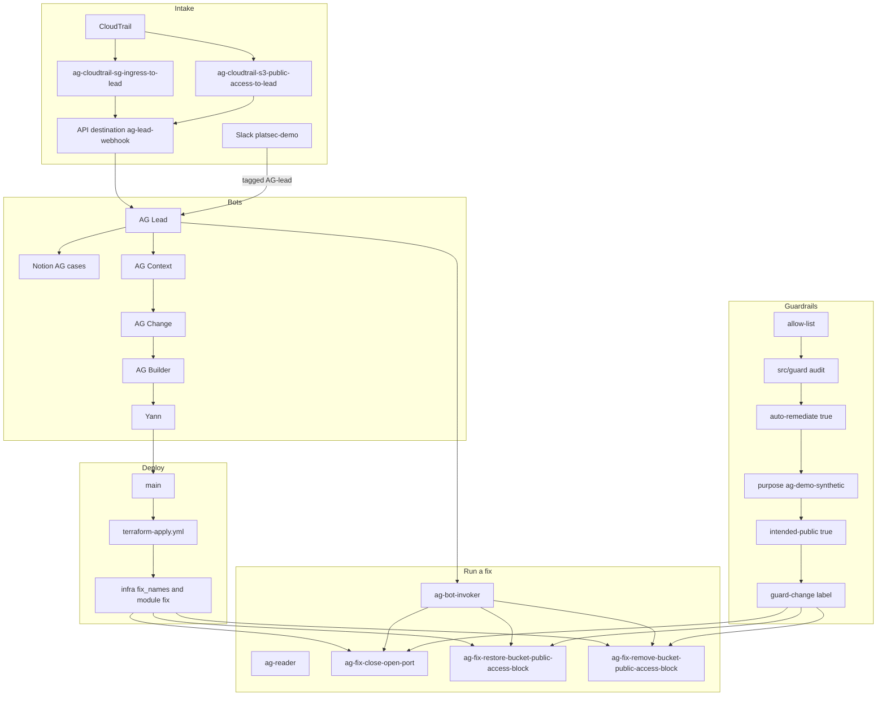

# Access Guardian

Access Guardian is a defensive demo for cloud access changes. Four Grok Bot agents handle intake, cases, and the conversation. This repository is the hard gate in front of a change: an allow-list, one Lambda per fix, IAM scoped to that fix, and a guard that checks the tree. A Lambda changes AWS only when the event has `apply` set to boolean `true`, and only after Yann says yes. Code lands only when Yann merges.

The bots, Slack, and Notion are not in this repository. Those parts are described here as they are operated. Every role, function, rule, tag, and workflow that this repository defines is taken from the code and the docs that match it.

## How a case flows



`ag-cloudtrail-sg-ingress-to-lead` matches successful `AuthorizeSecurityGroupIngress` only. `ag-cloudtrail-s3-public-access-to-lead`, `ag-bot-invoker`, and `ag-reader` are created outside Terraform (manual). This repository does not say which bot assumes `ag-reader`.

### Intake

CloudTrail sends events through EventBridge rules to an API destination. The destination POSTs to AG Lead's webhook routine. There is no Lambda on that path. See [docs/intake.md](docs/intake.md).

`ag-cloudtrail-sg-ingress-to-lead` is on the default bus. It matches successful `AuthorizeSecurityGroupIngress` events. A failed call and a dry run set `errorCode`, and those events are left out. The connection and the API destination are both named `ag-lead-webhook`. The rule target uses role `ag-eventbridge-to-ag-lead`, which may call `events:InvokeApiDestination` on that destination. The target retries 3 times within 1 hour. The input transformer sends the fields listed in [docs/intake.md](docs/intake.md), each as a string. `source` is the constant `aws-cloudtrail`. That rule was created by hand.

`ag-cloudtrail-s3-public-access-to-lead` is created outside Terraform (manual). Its event pattern is not written in this repository.

Slack channel `platsec-demo` also reaches AG Lead, and only when the message tags `@AG-lead`. No Slack code lives here.

TODO: move `ag-reader`, `ag-bot-invoker`, and `ag-cloudtrail-s3-public-access-to-lead` into `infra/`.

### Bots

These four agents are Grok Bots. They are not code in this repository.

- **AG Lead** takes intake, keeps cases, speaks in Slack as `@AG-lead`, writes Notion `AG cases`, and holds the approvals gate.
- **AG Context** records who, why, the owner, and the intended state. Identity is merged into AG Context.
- **AG Change** picks the fix or proposes a build.
- **AG Builder** writes the fix pull request through a Cursor cloud agent.

Yann reviews and merges. Yann's Slack id is `U0CAKUDP3L0`. That is the only person whose messages count as approvals.

### Deploy

A merge to `main` runs [.github/workflows/terraform-apply.yml](.github/workflows/terraform-apply.yml). The workflow tests, typechecks, builds the fix zips with [scripts/build-fixes.sh](scripts/build-fixes.sh), and applies [infra/](infra/). [infra/main.tf](infra/main.tf) lists `local.fix_names`. The module at [infra/modules/fix](infra/modules/fix) creates, for each name, role `ag-fix-<name>`, the inline policy from that folder's `policy.json`, log group `/aws/lambda/ag-fix-<name>`, and function `ag-fix-<name>`. The function runtime is Node 20, the handler is `index.handler`, and the role always sets `permissions_boundary` to `ag-fix-boundary`. The region is `ap-southeast-1`.

Pull requests run [.github/workflows/terraform-plan.yml](.github/workflows/terraform-plan.yml). That workflow checks protected paths, and it plans only when `src/fixes/`, `infra/`, the build script, or a Terraform workflow changed. Apply runs on `main` only.

The one-time bootstrap (OIDC, plan role, apply role, boundary, state backend) is hand-built. See [docs/aws-setup.md](docs/aws-setup.md).

### Running a fix

AG Lead assumes `ag-bot-invoker` and invokes the fix Lambda. That role is created outside Terraform (manual). Its permission is `lambda:InvokeFunction` on `ag-fix-*`. `ag-reader` handles read-only checks and is created outside Terraform (manual).

The handler defaults to a dry run. `apply` is omitted or set to `false` on the first invoke. Boolean `true` is the only value that writes, and Lead sets it only after Yann's yes. A second run that finds the desired state returns `changed: false`.

Each fix Lambda has its own role, `ag-fix-<name>`. The IAM tag conditions are in the next section.

## Fixes on main

`src/fixes/allow-list.ts` is the list this repository will automate. `src/fixes/registry.ts` is derived from it. A bot invokes `ag-fix-<name>`. All three names below are in `local.fix_names`, and each has a folder, a test, and an allow-list entry. The remove fix is complete on `main`. It is not a partial folder.

| Folder and function | Finding key | IAM action | What the handler does |
| --- | --- | --- | --- |
| `close-open-port`, function `ag-fix-close-open-port` | `cloud:open_port` | `ec2:RevokeSecurityGroupIngress` | Revokes one ingress rule on one security group. Protocol is `tcp` or `udp`, one port, one IPv4 CIDR. |
| `restore-bucket-public-access-block`, function `ag-fix-restore-bucket-public-access-block` | `cloud:s3_public_access_block_removed` | `s3:PutBucketPublicAccessBlock` | Turns on all four Block Public Access flags for one bucket whose name starts with `ag-demo-`. |
| `remove-bucket-public-access-block`, function `ag-fix-remove-bucket-public-access-block` | `cloud:s3_public_access_block_drift_intended_public` | `s3:PutBucketPublicAccessBlock` | Removes Block Public Access on bucket `ag-demo-public-10281729` only. The SDK call is `DeletePublicAccessBlockCommand`. AWS authorizes that API with `s3:PutBucketPublicAccessBlock`. |

Success reasons:

- `close-open-port`: `dry_run`, `already_closed`, or `revoked`.
- `restore-bucket-public-access-block`: `dry_run`, `already_blocked`, or `restored`. The four flags on the put are hardcoded true.
- `remove-bucket-public-access-block`: `dry_run`, `already_absent`, or `removed`.

`close-open-port` lists an undo on the allow-list: authorize that same ingress rule again. The handler does not perform the undo. The two bucket fixes list `There is no undo`.

A fix calls Grok only when `fix.json` says `callsGrok` is true. All three say `false`. The only xAI call in this repository is `extract()` in [src/grok/client.ts](src/grok/client.ts). Temperature is 0, the timeout is 15 seconds, and a failure is `no_key`, `timeout`, `http_error`, `bad_json`, or `schema_mismatch`. CloudTrail intake is structured. That path does not call Grok.

## IAM tag conditions

Taken from each `policy.json` and handler.

- **`ag-fix-close-open-port`.** The revoke statement allows `ec2:RevokeSecurityGroupIngress` on `arn:aws:ec2:*:*:security-group/*` only when both `aws:ResourceTag/auto-remediate` is `true` and `aws:ResourceTag/purpose` is `ag-demo-synthetic`. The two read actions have no tag condition and use `Resource` `*`. The handler checks `auto-remediate=true` before a revoke, including a dry run that would revoke. The handler does not check `purpose`.
- **`ag-fix-restore-bucket-public-access-block`.** Both statements use `arn:aws:s3:::ag-demo-*`. Neither statement has a tag condition. The handler requires `purpose=ag-demo-synthetic` and `auto-remediate=true`. It refuses a bucket that has `intended-public=true` and leaves that bucket unchanged.
- **`ag-fix-remove-bucket-public-access-block`.** Both statements use `arn:aws:s3:::ag-demo-public-10281729`. The mutating statement requires `aws:ResourceTag/intended-public` to be `true`. The read statement has no tag condition. The handler requires `intended-public=true`, `auto-remediate=true`, and `purpose=ag-demo-synthetic` before the delete. It does not read case text. The intended state comes from `intended-public=true`.

`src/guard/audit.ts` requires every allow-listed handler to declare `auto-remediate` and to call `hasAutoRemediateTag` before its mutating send. The two bucket handlers must also check `intended-public` before that send: present for the remove fix, absent for the restore fix.

`src/policy/classify-ingress.ts` classifies one ingress rule as `ok` or `finding`. It makes no AWS call and no Grok call. A rule is world-open when any CIDR is `0.0.0.0/0` or `::/0`. A rule that is not world-open is ok. A world-open rule on a sensitive port is always a finding, even when the security group is tagged. Protocol `-1`, a port range that overlaps a sensitive port, and a missing or unparseable port count as sensitive. Missing or unparseable ports fail closed. Any other world-open port, including 80 and 443, is a finding unless the security group tag `intended-public=true` is set. The key and the value are exact and case-sensitive. That is the same tag the S3 fixes use. The port list, with ranges expanded, is `src/policy/sensitive-ports.ts`.

## Guardrails

- **Allow-list and `src/guard` audit.** A fix folder needs `handler.ts`, `policy.json`, `fix.json`, a test, an allow-list entry, a registry row, and a `fix_names` entry. One mutating action, no wildcards, and that action must be on the close-only list in `src/guard/mutating-apis.ts` (`ec2:RevokeSecurityGroupIngress`, `s3:PutBucketPublicAccessBlock`). The guard blocks `Authorize*`, IAM action names matching `Delete*PublicAccessBlock`, `iam:*`, and `Put*Policy`. `DeletePublicAccessBlockCommand` is allowed only in `src/fixes/remove-bucket-public-access-block/handler.ts`, and only when the three tag checks come before the send. The command is not renamed. Shell, `eval`, and a dynamic import are forbidden in `src/`. An xAI call outside the Grok client fails the guard.
- **`guard-change` label.** [scripts/check-protected-paths.mjs](scripts/check-protected-paths.mjs) fails a pull request that edits a protected path unless that label is present. Protected paths match [.github/CODEOWNERS](.github/CODEOWNERS): `src/guard/`, `tests/guard*`, `infra/modules/`, `.github/`, `src/fixes/allow-list.ts`, and `.cursor/`. Yann adds the label. An agent does not.

## Commands

Node 20 or newer. `XAI_API_KEY` is read only when a live call is intended. Tests mock the network and pass with no key set. Do not commit the key.

```bash
npm test
npx tsc --noEmit
terraform -chdir=infra fmt -check -recursive
terraform -chdir=infra init -backend=false
terraform -chdir=infra validate
```

Local validate uses `-backend=false` so init does not contact AWS. The GitHub workflows pass the state backend from repository variables and are the path that plans and applies.

More detail: [docs/architecture.md](docs/architecture.md), [docs/demo-runbook.md](docs/demo-runbook.md), [docs/intake.md](docs/intake.md), [docs/aws-setup.md](docs/aws-setup.md).
