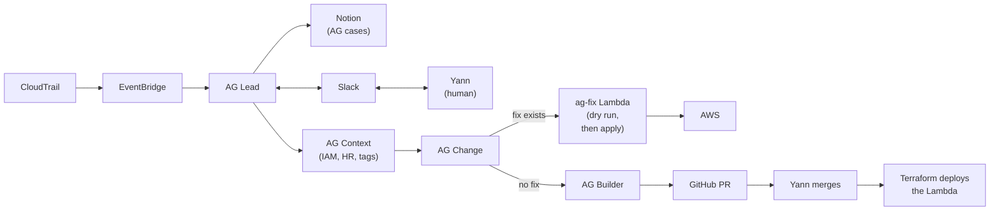

# Access Guardian

Access Guardian is a defensive demo. The bots triage risky cloud changes. This repository is the gate in front of a change: an allow-list, one Lambda per fix, and a guard that checks the tree.

## Problem

Cloud teams already have too many changes to review, and agentic tools will keep adding more. Checking whether a change is legitimate is slow, so real risk gets lost in the volume. The red flags are a user on leave making changes, a bucket's public or private state flipped against its intent, and a sensitive port opened to any outside range.

## Flow

The diagram uses the same edges as [site/slides.md](site/slides.md).

CloudTrail events go through EventBridge to AG Lead. Lead records the case in Notion under AG cases and talks with Yann in Slack. Cases are discussed in #platform-security. Lead asks AG Context for IAM, HR, and tags, and Context passes the case to AG Change. When a fix exists, Change runs the ag-fix Lambda. The Lambda does a dry run, then applies, and the write goes to AWS. When no fix exists, Change asks AG Builder. Builder opens a GitHub pull request. Build discussion is in #platform-security-build. Yann merges, and Terraform deploys the Lambda.

The four bots are not code in this repository. The EventBridge intake is still created by hand. See [docs/intake.md](docs/intake.md).

## Deployed fixes

`src/fixes/allow-list.ts` names the fixes this repository will automate. `infra/main.tf` lists the same names in `local.fix_names`. Each fix has one IAM action. The handler defaults to a dry run and writes only when `apply` is boolean `true`. A second run that finds the desired state returns `changed: false`.

`src/guard/audit.ts` requires every allow-listed handler to call `hasAutoRemediateTag` before its mutating send. The close-only actions in `src/guard/mutating-apis.ts` are `ec2:RevokeSecurityGroupIngress`, `s3:PutBucketPublicAccessBlock`, and `iam:PutUserPolicy`.

A fix returns a resource to its recorded intended state. `remove-bucket-public-access-block` is the one fix that opens access, and only when the handler and the IAM tag condition both see `public=true` on a bucket that also has `auto-remediate=true` and `purpose=ag-demo-synthetic`. The other fixes stay close-only.

### close-open-port

Action: `ec2:RevokeSecurityGroupIngress`. Finding key: `cloud:open_port`. Function: `ag-fix-close-open-port`.

The handler revokes one ingress rule on one security group. Protocol is `tcp` or `udp` with one port, or `-1` with no port, plus one IPv4 CIDR. It revokes only when exactly one ingress rule matches. For `tcp` and `udp`, zero matches returns `already_closed`, and more than one match returns `NotOneRule`. For protocol `-1`, zero matches and more than one match are refused.

When one rule matches, the handler requires `auto-remediate=true`, including on a dry run that would revoke. It then calls `classifyIngress()` on the named protocol, port, and CIDR, with the security group tags. A verdict of `ok` returns `status` `refused` and reason `rule is not a finding under the port rule`, and the rule stays. IAM allows the revoke on a security group only when `auto-remediate` is `true` and `purpose` is `ag-demo-synthetic`. A missing `purpose` tag can pass the handler and fail in IAM on the revoke.

`classifyIngress()` in `src/policy/classify-ingress.ts` makes no AWS call. A sensitive port is a finding when any IPv4 or IPv6 source is not fully inside private space (`10.0.0.0/8`, `172.16.0.0/12`, `192.168.0.0/16`, `100.64.0.0/10`, and `fc00::/7`). A range that only partly overlaps that space, and a CIDR that cannot be parsed, are findings. Protocol `-1`, a port range that overlaps a sensitive port, and a missing or unparseable port count as sensitive. A sensitive port whose source reaches outside private space is still a finding when the group is tagged `public=true`. Any other port is a finding only when it is world-open (`0.0.0.0/0` or `::/0`) and the group has no `public=true` tag. World-open ports 80 and 443 pass only when that tag is set. The key and the value are exact and case-sensitive. The port list is `src/policy/sensitive-ports.ts`.

Success reasons: `dry_run`, `already_closed`, `revoked`. Undo is a human step: authorize that same ingress rule again.

### restore-bucket-public-access-block

Action: `s3:PutBucketPublicAccessBlock`. Finding key: `cloud:s3_public_access_block_removed`. Function: `ag-fix-restore-bucket-public-access-block`.

The handler turns on all four Block Public Access flags for one bucket whose name starts with `ag-demo-`. The flags are `BlockPublicAcls`, `IgnorePublicAcls`, `BlockPublicPolicy`, and `RestrictPublicBuckets`, all hardcoded true. It refuses a bucket tagged `public=true` (`PublicBucket`) and leaves that bucket unchanged. It requires `purpose=ag-demo-synthetic` and `auto-remediate=true`. IAM scopes the role to buckets named `ag-demo-*` and has no tag condition.

Success reasons: `dry_run`, `already_blocked`, `restored`. There is no undo.

### remove-bucket-public-access-block

Action: `s3:PutBucketPublicAccessBlock`. Finding key: `cloud:s3_public_access_block_drift_public`. Function: `ag-fix-remove-bucket-public-access-block`.

The handler removes Block Public Access on bucket `ag-demo-public-10281729` only. The SDK call is `DeletePublicAccessBlockCommand`. AWS authorizes that API with `s3:PutBucketPublicAccessBlock`. The handler requires `public=true`, `auto-remediate=true`, and `purpose=ag-demo-synthetic` before the delete. The intended state comes from `public=true`. IAM scopes the role to that bucket. The mutating statement requires `public=true`. The read statement has no tag condition.

Success reasons: `dry_run`, `already_absent`, `removed`. There is no undo.

### contain-iam-user

Action: `iam:PutUserPolicy`. Finding key: `identity:on_leave_user_activity`. Function: `ag-fix-contain-iam-user`.

The handler attaches the inline policy `ag-containment-deny` to one IAM user. The document is a fixed deny of every action on every resource. Input cannot change the name or the document. `hrStatus` must be exactly `On leave`. The handler trusts that field as given. `userName` must be a plain IAM user name. The handler refuses a user name that starts with `ag-`, an ARN, or a role, assumed-role, or SSO principal. The user must exist and must carry `auto-remediate=true` and `purpose=ag-demo-synthetic`. The handler refuses an admin: an attached `AdministratorAccess` or `IAMFullAccess` policy, or membership in the group `Admin`, `Administrators`, or `Administrator`. IAM allows the put, and the reads other than `iam:ListUserTags`, on an IAM user only when both tags match. `iam:ListUserTags` has no tag condition.

Success reasons: `dry_run`, `already_contained`, `contained`. Undo is a human step: delete the inline policy `ag-containment-deny`.

### Daily report

`ag-report-daily` is a read-only Lambda. It is not a fix and it is not in `fix_names`. EventBridge Scheduler runs it daily at 00:00 UTC (08:00 SGT). It reads CloudTrail, asks Grok through `extract()` in `src/grok/client.ts` for a summary and suspected findings, checks suspected open ports with `classifyIngress()`, and posts the report to #platform-security. It does not open a case and it does not change AWS. Findings become cases only through AG Lead intake.

## Opt-in tags

A resource this demo may change carries `auto-remediate=true` and `purpose=ag-demo-synthetic`. A resource that is meant to be public also carries `public=true`. The key and the value are exact and case-sensitive. `public=true` is the only record of intended public state.

## Auto-remediation

A fix runs without asking when its guards and tags pass. The handler still defaults to a dry run, and only boolean `true` for `apply` writes. A human is asked only for intent, for a build, for a merge, and for a guard change.

## The guard-change label

Protected paths need the `guard-change` label. Those paths are `src/guard/`, `tests/guard*`, `infra/modules/`, `.github/`, `src/fixes/allow-list.ts`, and `.cursor/`. [scripts/check-protected-paths.mjs](scripts/check-protected-paths.mjs) fails the pull request when one of them changes and the label is absent. Only Yann adds the label.

## Deploy prerequisite

The apply role `ag-tf-apply` (repository variable `AG_TF_APPLY_ROLE_ARN`) needs `secretsmanager:DescribeSecret` on the secret `platsec-xai-api-key`. `infra/report.tf` looks that secret up by name when Terraform deploys the daily report.

## In review

None.
