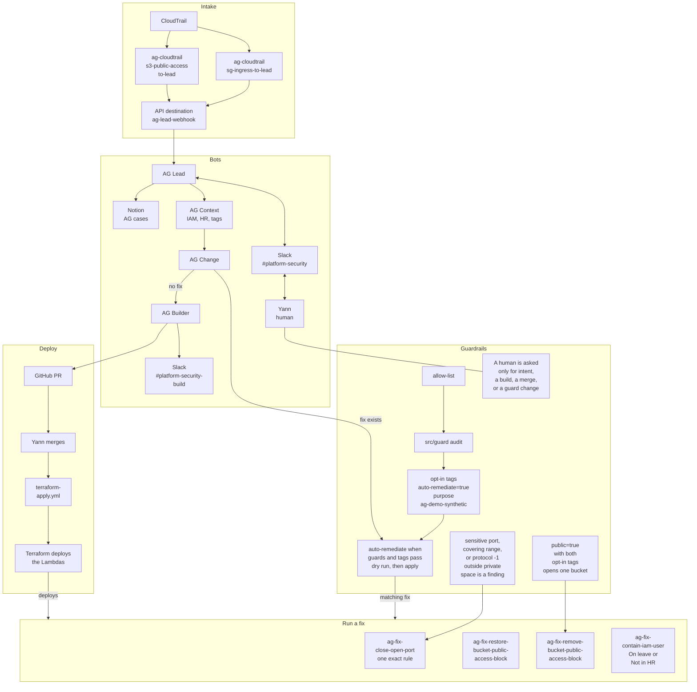

# Access Guardian

Automated triage and fixes for risky cloud changes.

---

## Problem and assumptions

**Problem**

- Cloud teams already have too many changes to review, and agentic tools will keep adding more.
- Checking whether a change is legitimate is slow, so real risk gets lost in the volume.
- Red flags: a user on leave or not in HR making changes, a bucket's public or private state flipped against its intent, a sensitive port opened to any outside range.

**Assumptions**

- If someone on leave is making changes, their keys or session were probably stolen.
- Tags record intended state (`public=true`, `auto-remediate=true`).
- CloudTrail, IAM and HR are the source of truth, not what anyone claims.

---

## Architecture

Same diagram as the README. The EventBridge rules are created by hand and are not in this repo. A fix runs when the guards and the opt-in tags pass. The handler dry-runs unless apply is true. A human is asked for intent, a build, a merge, or a guard change.

---

## On main

- **close-open-port.** One exact revoke: a single port or a from-to range, IPv4 or IPv6, or protocol -1 with no port. A sensitive port, a range that covers one, or protocol -1 is a finding when the source is outside private space.
- **contain-iam-user.** On leave (`identity:on_leave_user_activity`) or Not in HR (`identity:suspicious_user_activity`). The boundary allows only the six IAM user actions.
- **Rule edits.** The daily report reads `ModifySecurityGroupRules` and judges each rule with `classifyIngress()`. A malformed edit is `ingress unparsed` and is not treated as ok. The hand-built EventBridge rule is not in this repo.
- **Daily report.** After apply, set the secret `ag-report-daily-slack-bot-token`. Terraform creates the name and does not set the value.

---

## Trade-offs and what's next

**Trade-offs**

- Writing, vetting and testing every rule takes real effort, but it pays off quickly in cases that close themselves.
- It depends on correct tags. Anything untagged gets reverted to private.
- Each fix does exactly one hardcoded action, which is safe but narrow.

**What's next**

- Analyse CloudTrail for the most frequent changes and build the highest-leverage rules first.
- Block bad changes before they happen, such as public buckets and untagged deploys, with deny policies.
