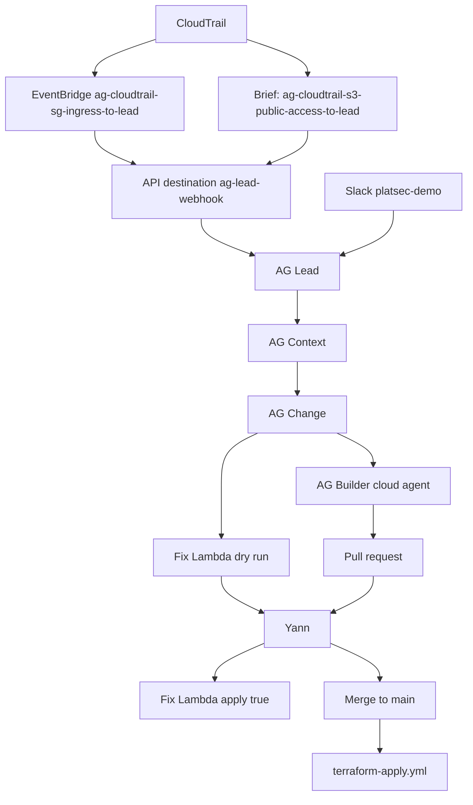

# Access Guardian

Defensive cloud security demo. The bots talk. This repo keeps the gates.

Presenter notes are on the prep page.

---

## Problem

Someone opens a port to the world, or Block Public Access on a demo bucket no longer matches the tags.

AG Lead, AG Context, AG Change, and AG Builder judge and talk. They are not in this repo.

This repo is the gate in front of a change:

- An allow-list of fixes.
- One Lambda per fix, one hardcoded action.
- A guard that fails a fix off the list, a policy that opens outside the one intended-public case, a wildcard, or an xAI call outside the Grok client.
- Yann's yes before a real AWS call.
- Yann's merge before code lands.

Dry run is the default. The Lambda changes AWS only when the event has `apply` set to true.

---

## Assumptions

Region `ap-southeast-1`. The CloudTrail intake is a hand-built EventBridge rule in `docs/intake.md`. That path has no Lambda.

A fix runs only on a tagged demo resource. `auto-remediate=true` is required. `purpose=ag-demo-synthetic` marks the demo. `intended-public=true` is the only recorded intended state that may remove a block, and only on one bucket. Case text does not set that state.

Grok does not authorize anyone. `extract()` returns schema-valid JSON or a typed failure. Code decides what happens next.

Synthetic data only. Tests mock the network and pass with no API key set.

TODO (Yann): who feels this, what it costs today, and who buys the fix. Those facts are not in the repo.

---

## Architecture

README.md on main has no mermaid diagram, so this one was drawn for the deck. Keep it in sync with the README pull request. The security group rule, the API destination, the four bots, and terraform-apply.yml are in the repo. The S3 rule name is from the demo brief and is not in docs/intake.md. Fix Lambdas on main: ag-fix-close-open-port, ag-fix-restore-bucket-public-access-block, ag-fix-remove-bucket-public-access-block.

---

## Trade-offs and what's next

A case dropped as authorized never reaches the gate. The allow-list, the dry run, and Yann's yes limit what a fix can do after a case is open. They do not raise a case that was skipped.

The intake transformer sends the first permission and the first IPv4 range. Two rules, or an IPv6-only rule, may never reach the webhook. CloudTrail still has the API call.

A bad input, a guard failure, a Grok timeout, or a schema miss produces no AWS call and no invented fact.

Before an enterprise rollout, the brief asks for SSO and RBAC instead of one Slack id, more than one account, a secrets store, a retention choice past the 14 day Lambda log groups, rate limits, and an inventory of intended state in place of tags. None of that is built here. The prep page marks the open choices TODO (Yann).
