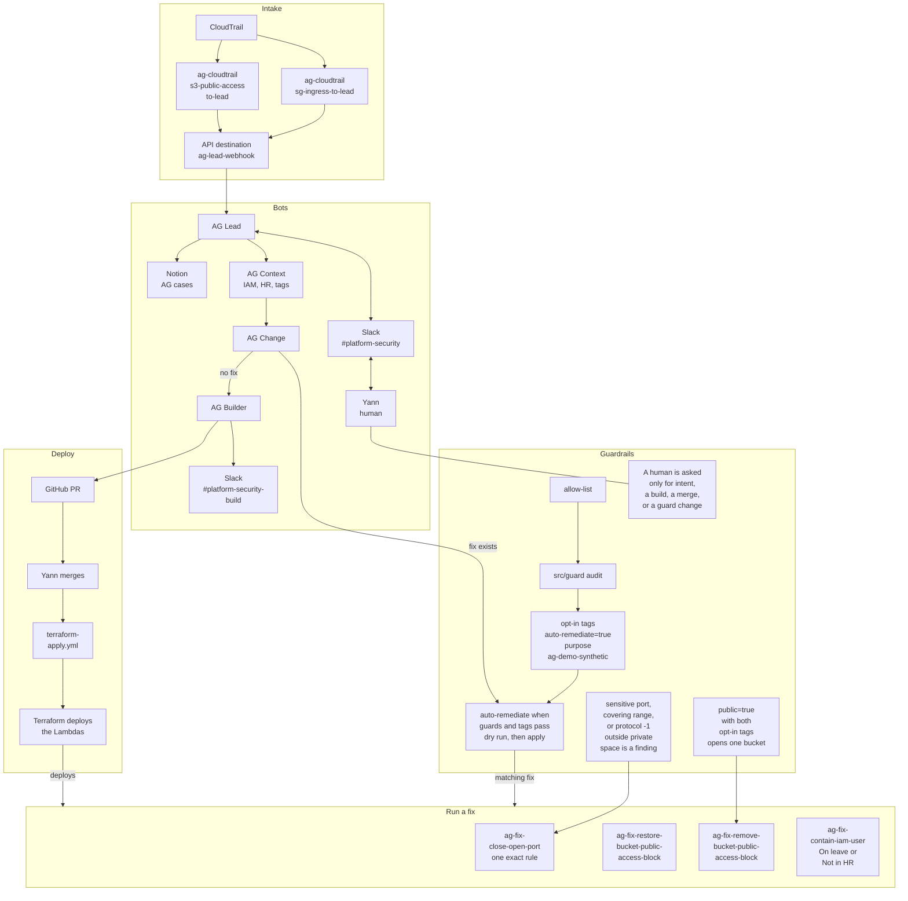

# Access Guardian

Automated triage and fixes for risky cloud changes.

---

## Problem and assumptions

**Problem**

- A person marked on leave in HR who is still making changes probably had their keys stolen, or they are working on holiday.
- How bad that is depends on severity. On-prem this is rarer. In cloud, country of origin is an extra signal.

**Assumptions**

- Tags that record intended state, such as `public=true`, are a weak point. A bad tag can make a bad state look intended. That is partly a process problem.
- Trust CloudTrail, IAM, and HR, not what anyone claims. They are extra context for a human decision, not a hard gate.

---

## Architecture

Same diagram as the README. The security group EventBridge rule is in Terraform. The S3 rule is still created by hand. A fix runs when the guards and the opt-in tags pass. The handler dry-runs unless apply is true. A human is asked for intent, a build, a merge, or a guard change.

---

## On main

- **close-open-port.** One exact revoke: a single port or a from-to range, IPv4 or IPv6, or protocol -1 with no port. A sensitive port, a range that covers one, or protocol -1 is a finding when the source is outside private space.
- **contain-iam-user.** On leave (`identity:on_leave_user_activity`) or Not in HR (`identity:suspicious_user_activity`). The boundary allows only the six IAM user actions.
- **Rule edits.** The daily report reads `ModifySecurityGroupRules` and judges each rule with `classifyIngress()`. A malformed edit is `ingress unparsed` and is not treated as ok. Rule `ag-cloudtrail-sg-ingress-to-lead` is in Terraform and matches that event plus `AuthorizeSecurityGroupIngress`. The S3 rule is still created by hand.
- **Daily report.** After apply, set the secret `ag-report-daily-slack-bot-token`. Terraform creates the name and does not set the value.

---

## Trade-offs and what's next

**Trade-offs**

- Separate bots stay a strength. Lead, Context, Change, and Builder each keep one job.
- Blocking a bad change before it lands is hard, and CI/CD tooling for that already exists. This project watches changes that skipped that tooling and show up in CloudTrail.

**Done**

- `ag-fix-contain-iam-user` attaches the inline deny `ag-containment-deny` to one risky IAM user.
- `ag-fix-close-open-port` closes a sensitive port whose source sits outside private address space.

---

## What's next

- Two roadmap inputs: the most frequent change types in CloudTrail, and a Checkov list of common misconfigurations.
- Cover each resource type, and the ways that type can be misconfigured. Later, CVEs via Dependabot.
- Extend the `writing-remediators` skill so AG Builder can cover new resources and new misconfigurations.
- Add scanner results and Dependabot to AG Context. More sources of truth help.
