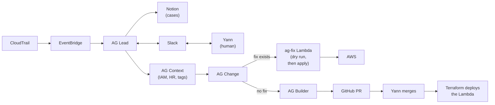

# Access Guardian

Automated triage and fixes for risky cloud changes.

---

## Problem and assumptions

**Problem**

- Cloud teams already have too many changes to review, and agentic tools will keep adding more.
- Checking whether a change is legitimate is slow, so real risk gets lost in the volume.
- Red flags: a user on leave making changes, a bucket's public or private state flipped against its intent, a sensitive port opened to any outside range.

**Assumptions**

- If someone on leave is making changes, their keys or session were probably stolen.
- Tags record intended state (`public=true`, `auto-remediate=true`).
- CloudTrail, IAM and HR are the source of truth, not what anyone claims.

---

## Architecture

Tags say it's safe to fix, so it's fixed and closed. Untagged public resources and open ports go back to private. A human is asked only for intent, builds and merges.

---

## Trade-offs and what's next

**Trade-offs**

- Writing, vetting and testing every rule takes real effort, but it pays off quickly in cases that close themselves.
- It depends on correct tags. Anything untagged gets reverted to private.
- Each fix does exactly one hardcoded action, which is safe but narrow.

**What's next**

- Analyse CloudTrail for the most frequent changes and build the highest-leverage rules first.
- Block bad changes before they happen, such as public buckets and untagged deploys, with deny policies.
- Contain-user: a deny-all policy on users who are on leave but still making changes.
- Flag sensitive ports open to any range outside private address space.
